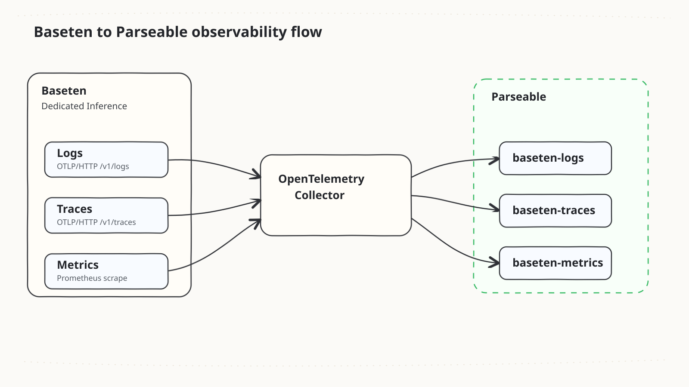
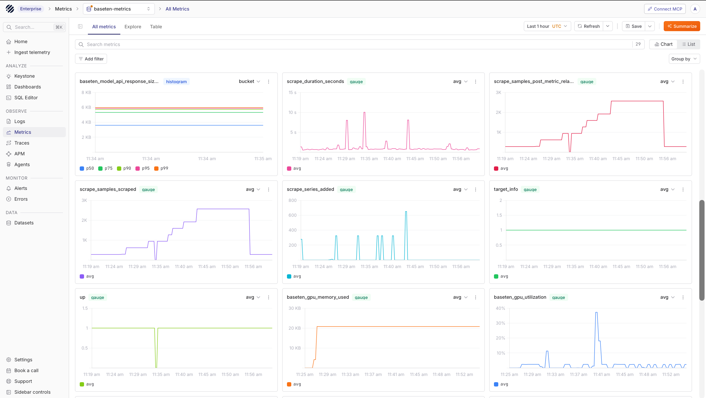
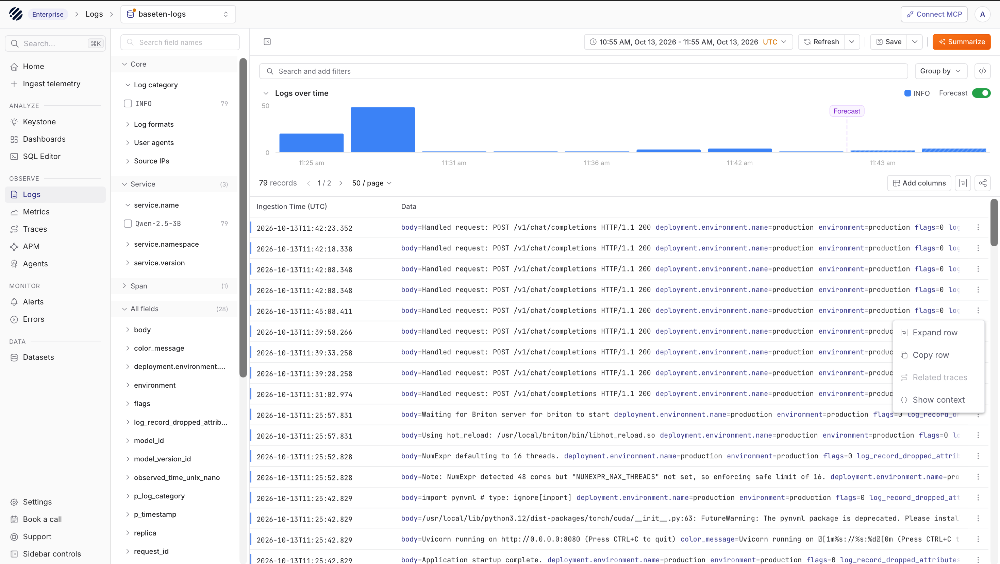
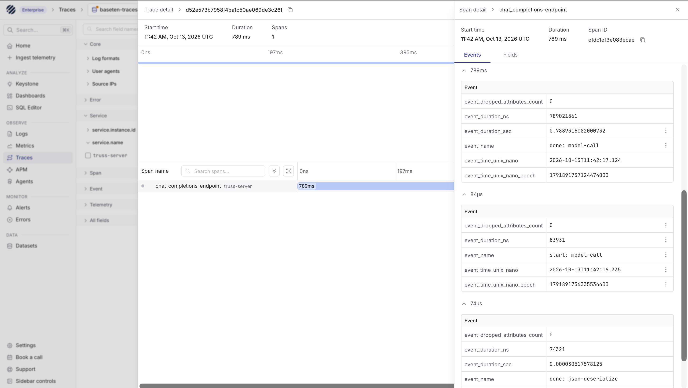
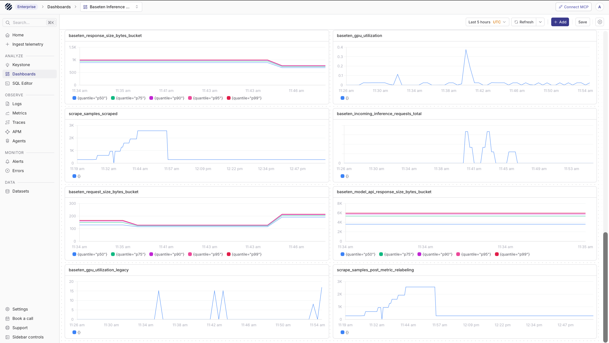
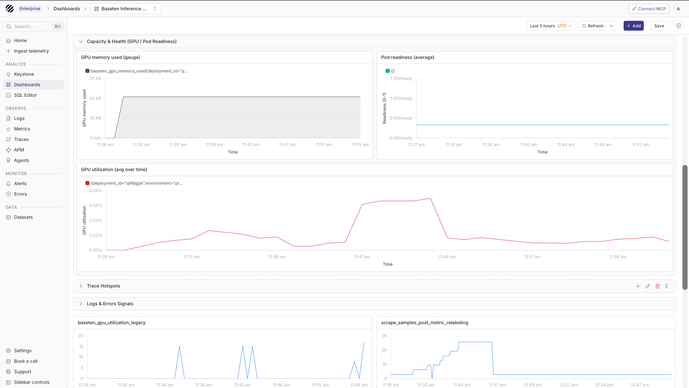
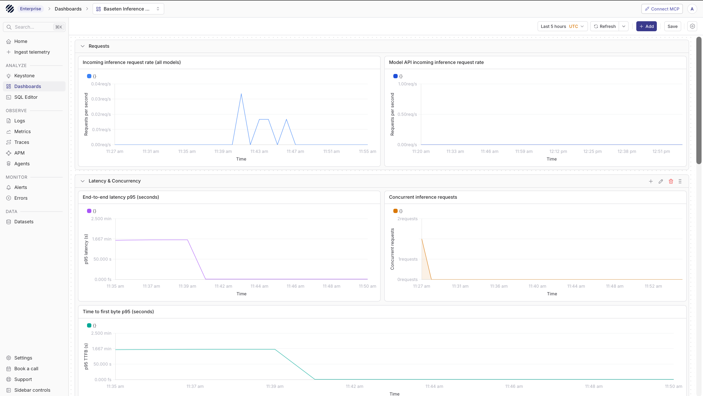

import { Step, Steps } from 'fumadocs-ui/components/steps';

[Baseten](https://www.baseten.co/) is an inference platform for deploying and serving machine learning models, including LLMs, behind production APIs. Teams commonly use Baseten Dedicated Inference with [Truss](https://docs.baseten.co/development/overview) to package a model, deploy it on managed GPU infrastructure, and expose an inference endpoint.

Parseable can store the telemetry that Baseten emits around those deployments. This guide shows how to send Baseten logs, built-in Truss traces, and deployment metrics to Parseable with an OpenTelemetry Collector.

## How it works

Baseten exports each signal differently:

- **Logs:** Baseten sends organization-level logs to an OTLP/HTTP logs endpoint.
- **Traces:** A Truss deployment can export built-in request spans to an OTLP/HTTP traces endpoint after you enable tracing in `config.yaml`.
- **Metrics:** Baseten exposes deployment metrics in Prometheus format at `https://app.baseten.co/metrics`; the Collector scrapes that endpoint and forwards the metrics to Parseable.

Use the Collector as the bridge between Baseten and Parseable. It keeps Parseable credentials out of the Truss config, receives OTLP from Baseten, scrapes Baseten metrics, and writes each signal into a separate Parseable dataset.



<Callout type="info">
Baseten trace export should point at a Collector instead of directly at Parseable when authentication is required. Baseten's trace configuration uses `environment_variables`, and Baseten recommends not putting authentication credentials there.
</Callout>

## Prerequisites

Before you start, keep these ready:

- A Baseten account and a Truss model deployed with Dedicated Inference
- The Baseten CLI authenticated locally
- An API key for invoking your model, and a Baseten workspace metrics export key
- A Parseable instance reachable from the Collector, and an API key with ingest access
- An OpenTelemetry Collector endpoint reachable from Baseten over HTTPS
- Docker, if you want to run the Collector with the example below

## Set up Baseten with Parseable

<Steps>
<Step>

### Create a Baseten metrics export key

Baseten deployment metrics are scraped separately from logs and traces. Create a metrics-only workspace key for the Collector:

```bash
baseten auth login

baseten org api-key create \
  --type workspace-export-metrics \
  --name metrics-export
```

To restrict the key to specific models, add one or more `--model-id` flags:

```bash
baseten org api-key create \
  --type workspace-export-metrics \
  --name metrics-export \
  --model-id <baseten-model-id>
```

Store the printed key securely. Baseten shows it once, and this key is only for exporting metrics.

</Step>
<Step>

### Configure the OpenTelemetry Collector

Create `otel-collector-config.yaml`:

This example exports OTLP JSON from the Collector to Parseable. `X-P-Stream` selects the Parseable dataset, and `X-API-Key` carries a Parseable API key with ingest access.

<Callout type="info">
OTLP Protobuf ingestion is available in Parseable Cloud and Enterprise. If your Parseable deployment supports Protobuf, you can switch the Parseable exporters below to `encoding: proto` and `Content-Type: application/x-protobuf`.
</Callout>

```yaml
extensions:
  health_check:
    endpoint: 0.0.0.0:13133

receivers:
  otlp:
    protocols:
      http:
        endpoint: 0.0.0.0:4318

  prometheus/baseten:
    config:
      scrape_configs:
        - job_name: baseten
          scheme: https
          metrics_path: /metrics
          scrape_interval: 60s
          static_configs:
            - targets: [app.baseten.co]
          authorization:
            type: Bearer
            credentials: ${env:BASETEN_METRICS_EXPORT_KEY}

processors:
  memory_limiter:
    check_interval: 1s
    limit_mib: 384
    spike_limit_mib: 96
  batch:
    timeout: 5s
    send_batch_size: 512

exporters:
  otlphttp/parseable_logs:
    endpoint: ${env:PARSEABLE_ENDPOINT}
    encoding: json
    headers:
      X-API-Key: ${env:PARSEABLE_API_KEY}
      X-P-Stream: ${env:PARSEABLE_LOGS_STREAM}
      Content-Type: application/json

  otlphttp/parseable_traces:
    endpoint: ${env:PARSEABLE_ENDPOINT}
    encoding: json
    headers:
      X-API-Key: ${env:PARSEABLE_API_KEY}
      X-P-Stream: ${env:PARSEABLE_TRACES_STREAM}
      Content-Type: application/json

  otlphttp/parseable_metrics:
    endpoint: ${env:PARSEABLE_ENDPOINT}
    encoding: json
    headers:
      X-API-Key: ${env:PARSEABLE_API_KEY}
      X-P-Stream: ${env:PARSEABLE_METRICS_STREAM}
      Content-Type: application/json

service:
  extensions: [health_check]
  pipelines:
    logs:
      receivers: [otlp]
      processors: [memory_limiter, batch]
      exporters: [otlphttp/parseable_logs]
    traces:
      receivers: [otlp]
      processors: [memory_limiter, batch]
      exporters: [otlphttp/parseable_traces]
    metrics:
      receivers: [prometheus/baseten]
      processors: [memory_limiter, batch]
      exporters: [otlphttp/parseable_metrics]
```

Configure the Collector environment:

```bash
export PARSEABLE_ENDPOINT="https://parseable.example.com"
export PARSEABLE_API_KEY="<parseable-api-key>"
export PARSEABLE_LOGS_STREAM="baseten-logs"
export PARSEABLE_TRACES_STREAM="baseten-traces"
export PARSEABLE_METRICS_STREAM="baseten-metrics"
export BASETEN_METRICS_EXPORT_KEY="<baseten-workspace-export-metrics-key>"
```

Run the Collector:

```bash
docker run --rm \
  -p 0.0.0.0:4318:4318 \
  -p 127.0.0.1:13133:13133 \
  -e PARSEABLE_ENDPOINT \
  -e PARSEABLE_API_KEY \
  -e PARSEABLE_LOGS_STREAM \
  -e PARSEABLE_TRACES_STREAM \
  -e PARSEABLE_METRICS_STREAM \
  -e BASETEN_METRICS_EXPORT_KEY \
  -v "$PWD/otel-collector-config.yaml:/etc/otelcol-contrib/config.yaml:ro" \
  otel/opentelemetry-collector-contrib:0.130.1 \
  --config=/etc/otelcol-contrib/config.yaml
```

Check the Collector health endpoint:

```bash
curl http://localhost:13133
```

The response should include `"status":"Server available"`.

<Callout type="warn">
Baseten must reach the Collector over HTTPS. For production, run the Collector behind a stable TLS endpoint and protect ingress with a reverse proxy, private networking, or an allowlist. Do not expose an unauthenticated OTLP receiver broadly on the internet.
</Callout>

For a short local proof of concept, put a temporary HTTPS tunnel in front of the local Collector:

```bash
ngrok http 4318
```

Use the generated HTTPS forwarding URL as the Collector base URL in the Baseten settings below.

</Step>
<Step>

### Export Baseten logs

Baseten log export is configured at the organization level, so one OTLP destination receives logs for the organization.

In the Baseten dashboard:

1. Open **Organization settings > General settings**.
2. In the **OTEL connection** card, choose **Add connection**.
3. Set **Endpoint URL** to the full Collector logs endpoint:

```text
https://otel.example.com/v1/logs
```

4. Set **Header name** to a header accepted by your Collector or edge proxy.
5. Set **Header value** to the credential for that header.
6. Add any additional headers required by your receiver.
7. Save the connection.

For the simple Collector example above, the Collector does not require an ingress credential. In a local proof of concept, you can use a harmless routing header to satisfy the Baseten form:

| Field | Value |
| --- | --- |
| Endpoint URL | `https://<collector-host>/v1/logs` |
| Header name | `X-P-Stream` |
| Header value | `baseten-logs` |

The Collector still decides the final Parseable dataset using `PARSEABLE_LOGS_STREAM`.

Baseten exports new log records only. Historical logs are not backfilled. Delivery is best effort: Baseten retries transient failures, but records can be dropped if retries are exhausted or the export buffer fills.

Baseten's connection test sends a probe only for supported vendor domains. Custom Collector or Parseable endpoints can still receive real logs even when the test action returns an error, so verify delivery with a real inference request.

If the OTEL connection card is not visible in your Baseten settings, contact Baseten support to enable log export for the organization.

</Step>
<Step>

### Export Truss traces

Built-in trace export applies to Dedicated Inference deployments that use the Truss server. For custom servers, configure OpenTelemetry instrumentation in your server or framework instead.

Enabling built-in trace export can add request overhead. Turn it on deliberately and check latency before using it for production traffic.

Update the Truss `config.yaml` for your model:

```yaml
environment_variables:
  OTEL_EXPORTER_OTLP_ENDPOINT: https://otel.example.com/v1/traces

runtime:
  enable_tracing_data: true
```

Use your public Collector trace endpoint and include `/v1/traces`.

Deploy the updated Truss:

```bash
truss push
```

If this creates a new deployment that is not serving production traffic yet, promote it from the Baseten dashboard or with your normal deployment workflow. Then send inference requests to generate traces.

In Parseable, Truss built-in spans usually have `service.name` set to `truss-server`.

</Step>
<Step>

### Export Baseten deployment metrics

The Collector configuration above scrapes:

```text
https://app.baseten.co/metrics
```

with `BASETEN_METRICS_EXPORT_KEY`, then forwards the data to the `baseten-metrics` dataset.

Keep the scrape interval at `60s`. Baseten rate limits the metrics endpoint to six requests per minute per organization across all keys and collectors.

After one scrape interval, verify scrape health before building dashboards. A healthy scrape should include an `up` sample for the `baseten` job, and the `baseten-metrics` dataset should start receiving deployment metric samples.

</Step>
<Step>

### Generate test telemetry

Send an inference request to the production environment:

```bash
export BASETEN_API_KEY="<baseten-api-key>"
export BASETEN_MODEL_ID="<baseten-model-id>"
export BASETEN_MODEL_NAME="<served-model-name>"

curl -sD- \
  "https://model-${BASETEN_MODEL_ID}.api.baseten.co/environments/production/sync/v1/chat/completions" \
  -H "Content-Type: application/json" \
  -H "Authorization: Bearer ${BASETEN_API_KEY}" \
  -d '{
    "model": "'"${BASETEN_MODEL_NAME}"'",
    "messages": [
      {
        "role": "user",
        "content": "Say hello from a Baseten deployment and emit normal serving telemetry."
      }
    ]
  }'
```

Keep the `X-Baseten-Request-Id` response header. It is useful for finding related Baseten logs.

</Step>
</Steps>

## Explore data in Parseable

Open Parseable and confirm that the datasets exist: `baseten-metrics`, `baseten-logs`, and `baseten-traces`.

Run quick checks from the Parseable query UI:

```sql
SELECT * FROM "baseten-metrics"
ORDER BY p_timestamp DESC
LIMIT 20;
```

```sql
SELECT * FROM "baseten-logs"
ORDER BY p_timestamp DESC
LIMIT 20;
```

```sql
SELECT * FROM "baseten-traces"
ORDER BY p_timestamp DESC
LIMIT 20;
```

Open `baseten-metrics` from the Metrics page. The dataset contains the Prometheus samples scraped from Baseten and forwarded through the Collector.



Open `baseten-logs` from the Logs page. The dataset shows Baseten serving logs, deployment metadata, service filters, and log volume over time.



Open `baseten-traces` from the Traces page. The dataset shows Truss request spans and related OpenTelemetry attributes for the deployment.



## Dashboards

After logs, traces, and metrics are flowing, create a Baseten inference dashboard to keep the main serving signals in one place. Use `baseten-metrics` for time-series charts, `baseten-logs` for deployment and serving events, and `baseten-traces` for span-level request investigation.

Start with an overview section for request size, GPU utilization, scrape health, incoming inference requests, and response size. This gives operators a quick read on whether the deployment is receiving traffic and whether the metrics scrape path is healthy.



Add a capacity and health section for GPU memory, pod readiness, and GPU utilization over time. These panels are useful while testing autoscaling behavior, confirming that a deployment has warmed up, and spotting unexpected resource usage.



Add a request section for incoming request rate, latency, concurrency, and time to first byte. These charts help connect model traffic with user-facing performance.



## Troubleshooting

| Symptom | What to check |
| --- | --- |
| No logs in Parseable | Confirm the Baseten OTEL connection uses `/v1/logs`, the Collector is reachable from Baseten, and new logs were generated after the connection was saved. |
| Baseten connection test fails for a custom domain | Baseten can still export logs to custom endpoints even when the dashboard test does not support that domain. Verify delivery in Parseable with a real prediction request. |
| No traces in Parseable | Confirm `runtime.enable_tracing_data: true`, the trace endpoint includes `/v1/traces`, the updated deployment is active, and the Collector is reachable over HTTPS. |
| No metrics in Parseable | Confirm `BASETEN_METRICS_EXPORT_KEY` is a `workspace-export-metrics` key and the Collector has been running for at least one scrape interval. |
| `401` from Parseable | Check `PARSEABLE_API_KEY`, the `X-API-Key` header, and that you are using the Parseable ingest endpoint. |
| `429` from Baseten metrics | Use a `60s` scrape interval and reduce the number of collectors scraping the organization metrics endpoint. |
| The deployment is costing money while testing | Deactivate or scale down the Baseten deployment when you are done generating telemetry. Reactivate it before sending more test inference requests. |

## References

- [Baseten logs](https://docs.baseten.co/observability/logs)
- [Baseten tracing](https://docs.baseten.co/observability/tracing)
- [Baseten metrics export](https://docs.baseten.co/observability/export-metrics/overview)
- [OpenTelemetry Collector](https://opentelemetry.io/docs/collector/)
