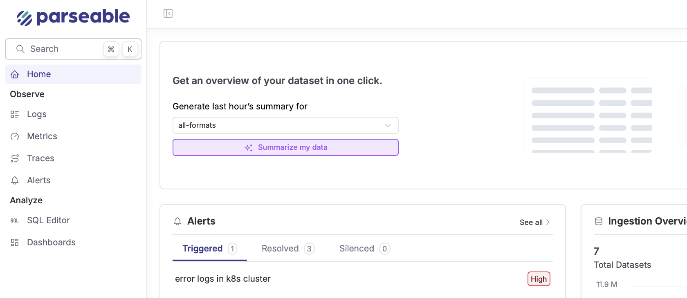
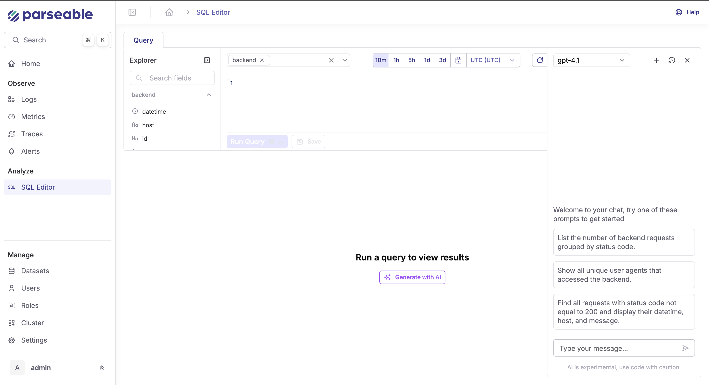
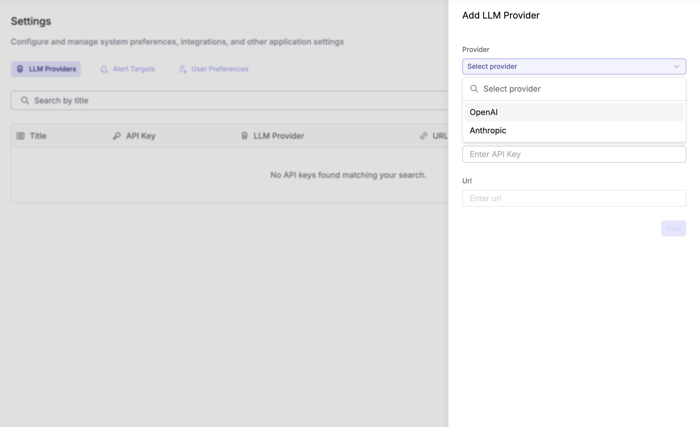

<OfferingPills cloud enterprise className="mb-4" />

Parseable brings AI-native capabilities to your observability workflow, helping you get answers faster and reduce mean time to resolution.

## Features

### Keystone

Ask questions about your telemetry data in natural language. Keystone uses multiple AI agents to find the best answer across your datasets.

<LocalVideo src="/docs-videos/keystone.mp4" title="Keystone AI-native observability workflow" />

[Learn more about Keystone →](/user-guide/ai-native/keystone)

### Dataset Summarization

Get AI-powered summaries of your datasets to quickly identify patterns, anomalies, and potential issues.

[Learn more about Summarization →](/user-guide/ai-native/summary)

### Text to SQL

Generate SQL queries from plain English descriptions. The AI assistant can also fix broken queries and explain complex SQL.

[Learn more about Text to SQL →](/user-guide/ai-native/text-to-sql)

See also: [Parseable AI Assistant](/llm/text-to-sql) for advanced LLM configuration options.

### Oncall platform summary

The Enterprise home page can display an AI-generated platform summary with platform health, overview text, ranked operational highlights, investigation prompts, platform statistics, generation time, next run time, model, and token and cost usage.

Each new summary contains exactly three `cannedOptions`. Each option has a `heading` and `prompt` that you can use to begin an investigation. Previously stored summaries without these options remain readable.

Use the following API endpoints to retrieve, generate, and configure summaries:

- `GET /api/v1/llm/platform_summary` retrieves the cached summary. It may return HTTP 204 when no cached summary exists.
- `POST /api/v1/llm/platform_summary/trigger` triggers summary generation and streams progress using server-sent events (SSE).
- `GET /api/v1/llm/platform_summary/config` reads the summary configuration.
- `PUT /api/v1/llm/platform_summary/config` updates the summary configuration.

The configuration contains `enabled`, `scanInterval`, and an optional `slackEndpoint`. In the UI, Home Overview settings are available at `/settings/oncall-agent`. Requests to `/settings/home-overview` redirect to that location.

Summary access requires `Action::QueryLLM`, while configuration updates require `Action::AddLLM`. Both operations also validate access to the tenant's datasets.

## Configuration

To enable AI features, configure your LLM provider:

1. Go to **Settings** > **AI Assistant**
2. Choose your preferred LLM provider (OpenAI GPT or Anthropic Claude)
3. Add your API key
4. Save your preferences

