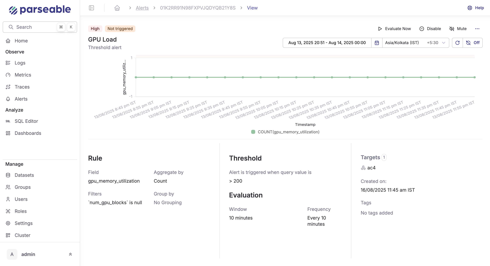
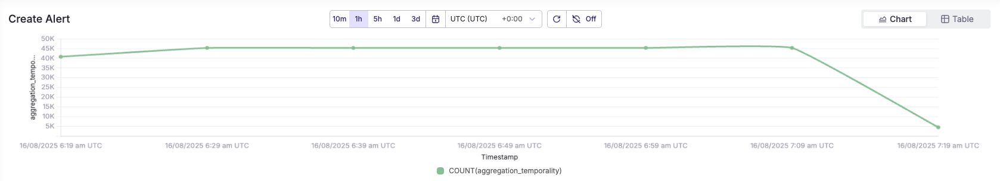
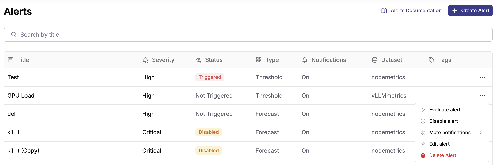

<OfferingPills cloud enterprise className="mb-4" />

Parseable offers realtime alerting based on contents of incoming events. Each dataset can have several alerts and each alert is evaluated independently.

## How to set-up alerts

1. Navigate to the Alerts page from the side navigation menu
2. Click on "Create Alert" to set up a new alert
3. Set the "Preview", it could be either chart or table for 10m, 1h, 5h 1d or any custom timerange.

To import an alert, select **Import Alert** from the **Create Alert** menu. You can upload a `.json` file or paste alert JSON. The imported JSON must be an object. The `id`, `version`, and `created` fields are removed before the alert is created. 
  

### Configure Alert Rules

Configure the alert rules for all alert types:

- **Dataset**: Select the log dataset or dataset you want to monitor
- **Monitor**: Choose the specific field to track (e.g., `response_time`, `error_count`, `status_code`)
- **Filter** (Optional): Add conditions to narrow down the data (e.g., `status = 500`, `environment = production`)
- **Group By** (Optional): Group results by specific fields for more granular alerting (e.g., group by `service_name` or `region`)

<LocalVideo src="/docs-videos/set-rule-alerts.mp4" title="Create an alert rule" />

Alert PromQL queries are validated before the **Run** action applies them. Blank input reports `Query is empty.`, while parser errors report `PromQL syntax error.`.

### Configure Targets

Targets are the destinations where notifications are sent when an alert is triggered. Parseable supports Webhook, Slack, and Alertmanager targets. Follow the [Alertmanager integration guide](/alerting/alert-manager) for advanced grouping, routing, and notification management.

The list of configured targets can be seen under Settings > Alert Targets.

Target IDs and names must be unique within a tenant. Creating a target with an existing tenant-scoped ID or name returns HTTP 409.

<LocalVideo src="/docs-videos/target.mp4" title="Configure an alert notification target" />

### Add Title and Save

- **Title**: Give your alert a descriptive name (e.g., "High CPU Usage", "API Error Rate")
- **Severity**: Select the appropriate level: Low, Medium, High, or Critical
- **Tags** (Optional): Add tags to categorize your alerts

Click **"Save"** to create your alert.

Alert creation accepts an optional `id`. If it is omitted, the server generates a ULID. Creating an alert with an existing ID or title in the same tenant returns HTTP 409. Updating an alert to use another alert's title also returns HTTP 409.

## Managing Alerts

After creating alerts, you can manage them from the Alerts page:

- **Evaluate alert**: Manually trigger an evaluation
- **Disable alert**: Temporarily disable without deleting
- **Mute notifications**: Stop notifications during maintenance
- **Edit alert**: Modify configuration
- **Delete Alert**: Permanently remove

Exported alert JSON omits the `id`, `version`, and `created` fields.
