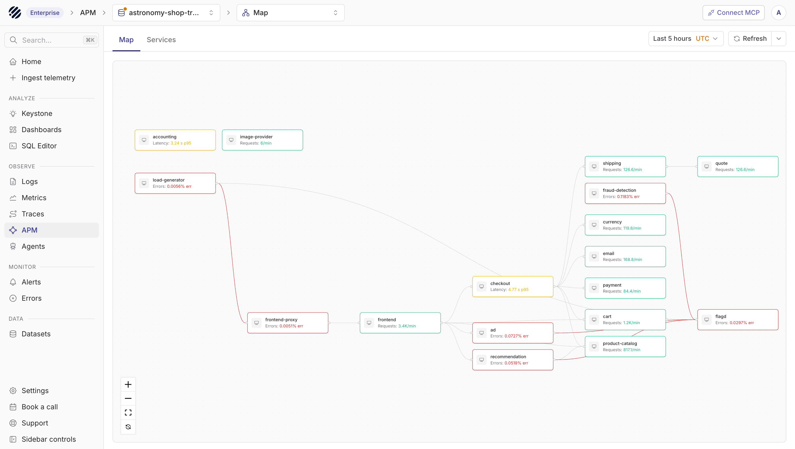
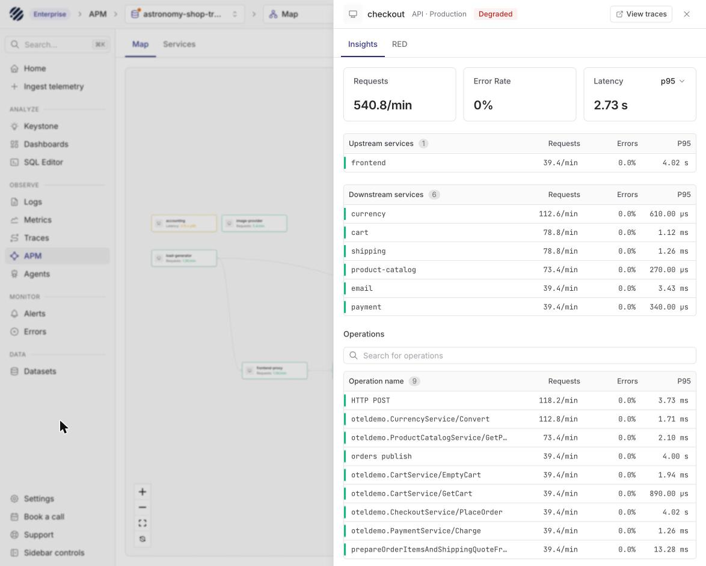
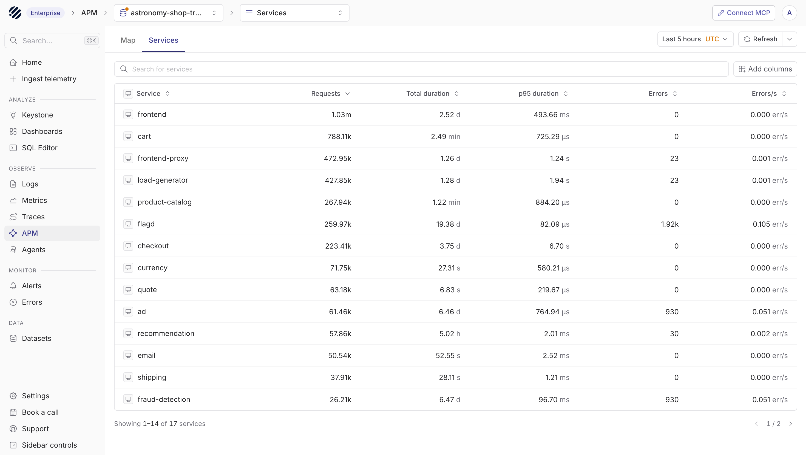
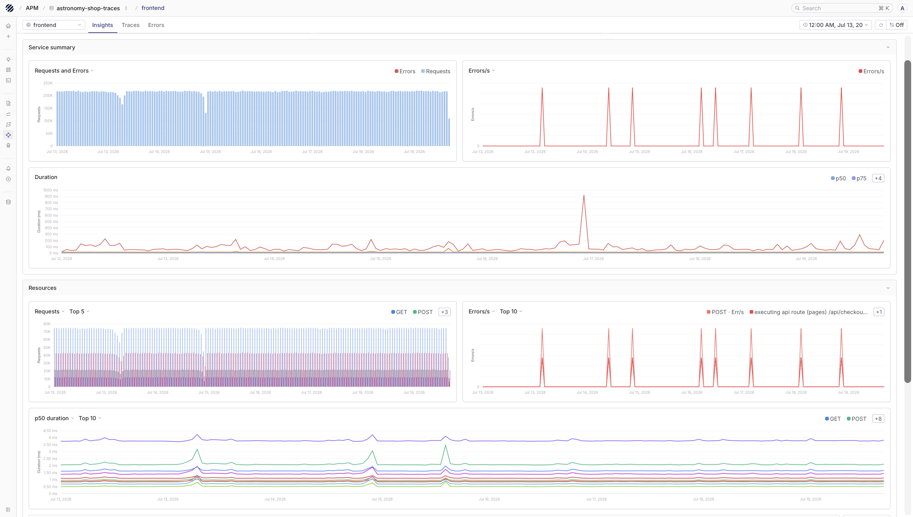
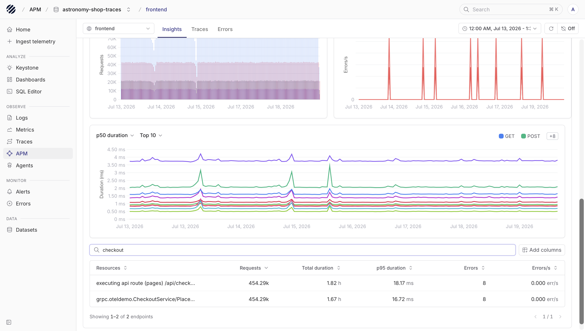
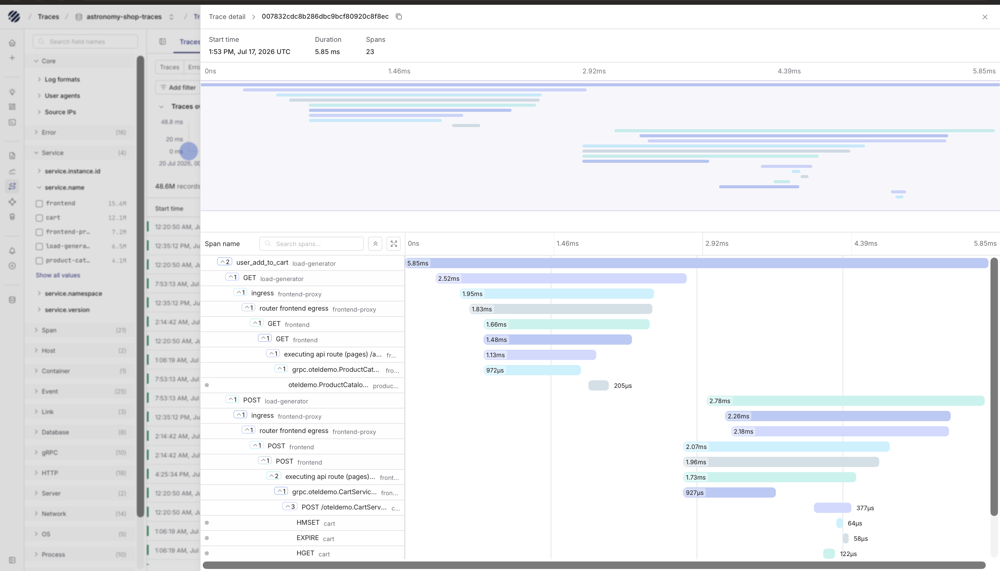
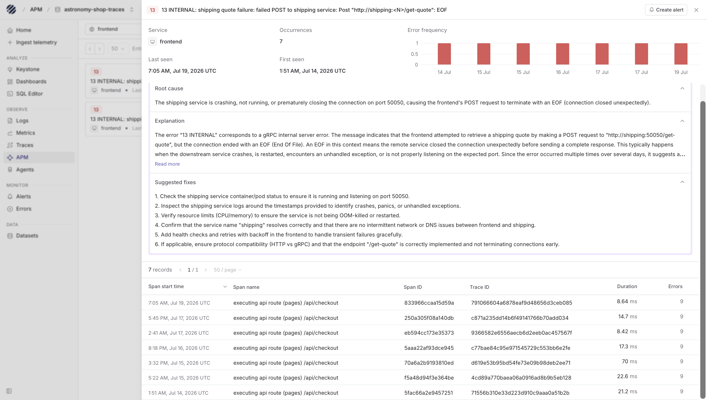

APM in Parseable gives you a service-level view of your traced applications. It is where you start when you know something is happening in the application, but you still need to understand which service is involved and which trace explains the behavior.

The page is built on trace data. You choose a trace dataset and then look at the services in it in one of two ways: as a `Map` that shows how services call each other, or as a `Services` list that you can sort and compare. From either view you can open a service and move between `Insights`, `Traces`, and `Errors`. The idea is simple: start from the service, understand the shape of traffic and failures, then open the trace that gives you the exact request path.

## APM with Parseable

The APM page is most helpful when you want to compare services by request volume, latency, and errors before opening individual traces. For example, you may want to know which service is receiving the most traffic, which one has the highest p95 duration, or whether errors are isolated to one service or visible across a larger request path.

APM is different from the raw Traces page because it starts from services. The Traces page is better when you already want to inspect trace records directly. APM is better when you want a higher-level service view first and then drill down.

<Callout type="info">
APM reads from trace datasets. Make sure your application is sending OpenTelemetry traces into Parseable before using this page.
</Callout>

## Page controls

The breadcrumb at the top of the page holds the main selectors, and the toolbar on the right controls which data is loaded.

### Dataset

Start from the `dataset selector` in the breadcrumb. Pick the trace dataset you want to inspect. The map, the services list, and every service-level view update around that dataset.

### Map and Services views

Next to the dataset selector, the `view selector` switches between `Map` and `Services`. The same choice is available as the `Map` and `Services` tabs below the breadcrumb. The selected view is kept in the page URL, so a link you share opens in the same view.

### Time range and timezone

The `time range` picker controls how much data is included. Use the presets (`10 min`, `30 min`, `1 hr`, `5 hrs`, `1 day`, and `3 days`) or pick a custom range with the calendar and the `From` and `To` fields. Hover over the picker to see the exact start and end of the current range.

A shorter range works well during an active incident or rollout, and it also loads faster. A wider range is better when you want to compare service behavior across days.

You can also choose the timezone in the picker, including UTC or your local timezone, so the charts and trace timestamps match how your team is investigating the issue.

### Refresh and auto-refresh

`Refresh` reruns the current queries. While a query is still running, the button changes to `Cancel` so you can stop a slow query and pick a smaller range.

The arrow next to `Refresh` turns on `auto-refresh`, with intervals of `10s`, `30s`, `1m`, `5m`, `10m`, and `20m`. `Auto-refresh` is useful when you are watching a live system and want the service view to keep updating.

## Service map

The `Map` view draws every service in the selected dataset as a node and every call between two services as an edge. Calls flow from left to right, so entry points such as a load generator or proxy sit on the left and the services they depend on sit further right.

Each node shows the service name and the one signal that matters most for that service right now:

- **Green** nodes are healthy and show request throughput, for example `Requests: 3.1K/min`.
- **Amber** nodes have high latency and show their p95 duration, for example `Latency: 1.59 s p95`.
- **Red** nodes are reporting errors and show their error rate, for example `Errors: 0.077% err`.

Edges that carry errors are drawn in red, which makes it easier to follow a failure from the service that reported it to the services that called it.

### Hover over services and calls

Hover over a node to see a summary card with the service type and environment (for example `API · Production`), requests per minute, error rate, and p95 latency.

Hover over an edge to see the same numbers for the calls between those two services only. This is useful when a service is called by several others and you want to know which caller sees the slow or failing requests.

### Click a service

Click a service to open its service panel, which shows the rate, errors, and duration over time for that service. Below it also shows a list of all the operations in that service. Click an individual operation to see its RED details.

### Focus on a service

Click `Focus` on a node's hover card to reduce the map to that service, the services that call it, and the services it calls. A `Focused` chip appears next to the tabs. Click the `x` on the chip to return to the full map.

### Map controls

The controls in the bottom-left corner let you zoom in, zoom out, and fit the whole map to the screen. Use `Reset service map layout` to return the nodes to their default positions.

### Service panel

Click a node to open the service panel. The header shows the service name, its type and environment, and a status badge such as `Degraded` when the service needs attention. Use `View traces` to open the full service view on its `Traces` tab.

The panel has two tabs.

**Insights** starts with three numbers for the selected time range: `Requests`, `Error Rate`, and `Latency`. The latency card has a percentile selector with `Avg`, `p50`, `p75`, `p90`, `p95`, `p99`, `p99.9`, and `Max`. Below the cards are three tables, each showing requests per minute, error rate, and p95 latency:

- `Upstream services`, the services that call this service
- `Downstream services`, the services this service calls
- `Operations`, the span names this service handles, with a search box to find a specific operation

**RED** shows the service's rate, errors, and duration over time:

- `Requests and Errors`, as totals or switched to `Requests/s and Errors/s`
- `Errors`, as totals or switched to `Errors/s`
- `Duration`, with `p50`, `p75`, `p90`, `p95`, `p99`, and `Max` lines

Close the panel with the `x` in its header or by pressing `Esc`.

## Services list

The `Services` view lists the services found in the selected trace dataset. Each row represents a service and gives you the basic health signals for that service.

By default, the table shows the service name, request count, total duration, p95 duration, errors, and errors per second. This makes it easy to scan the application from a service point of view instead of starting with thousands of individual spans.

The `search` bar helps when you already know the service name. Click a column header to sort by it, which brings the busiest, slowest, or highest-error services to the top.

Use `Add columns` to change which metrics the table shows. You can choose:

- **Requests**: `Requests`, `Requests/s`
- **Duration**: `Total duration`, `Average duration`, `p50 duration`, `p75 duration`, `p90 duration`, `p95 duration`, `p99 duration`, `p99.9 duration`, `Max duration`
- **Errors**: `Errors`, `Errors/s`, `Error rate`

Use `Reset` in the same menu to go back to the default columns.

The list uses the selected dataset and `time range`, so changing either one updates the service table around the same investigation context.

## Open a service

Click a service row in the `Services` view, or `View traces` in the map's service panel, to open the service-level APM view. This scopes the page to that service and gives you three tabs. `Insights` shows request, duration, error, and resource charts. `Traces` shows traces related to the selected service. `Errors` groups the failures reported by the service.

The `service selector` in the breadcrumb lets you move between services without returning to the main list. This is useful when you are comparing two services during the same investigation.

## Insights tab

The `Insights` tab is the first place to look after opening a service. It summarizes the selected service over the current `time range`.

At the top, three cards show `Total requests`, `Duration`, and `Error rate`. The duration card has a percentile selector with `Avg`, `p50`, `p75`, `p90`, `p95`, `p99`, `p99.9`, and `Max`.

### Service summary

The `Service summary` section shows how the service behaved over time:

- `Requests and Errors`, as totals or as `Requests/s and Errors/s`
- `Errors`, as totals or as `Errors/s`
- `Duration`, with one line per percentile. Click the `+4` badge in the legend to see the rest of the percentiles.

This is where you can quickly tell whether traffic changed, whether errors appeared as one-off spikes or repeated patterns, and whether latency moved at the same time as request volume.

### Resources

The `Resources` section breaks the service down by route or operation. It starts with three charts, each limited to the `Top 5` or `Top 10` resources:

- `Requests` or `Requests/s` per resource
- `Errors` or `Errors/s` per resource
- Duration per resource, using the metric you pick: `Avg duration`, `p50 duration`, `p75 duration`, `p90 duration`, `p95 duration`, `p99 duration`, `p99.9 duration`, or `Max duration`

Below the charts, the resources table lists every endpoint or operation with its requests, total duration, p95 duration, and errors. When you already know the route or operation name, search within resources. Sort by any column, and use `Add columns` to choose the same request, duration, and error metrics that are available on the services list.

Click a resource row to open its own panel. The header shows the resource name and the service it belongs to, for example `From: fraud-detection · Operation`. The panel shows requests, error rate, and latency for that resource, followed by its `Requests and Errors`, `Errors`, and `Duration` charts. Use `View traces` to see the traces for that resource, or the back arrow to return.

For example, if a service has an error spike, use the resource charts and table to check whether the errors are coming from one route, one operation, or the service more broadly.

## Traces tab

The `Traces` tab shows traces related to the selected service. It becomes useful once `Insights` tells you that something changed and you want to open the actual traces behind that change.

The tab opens with a `service.name` filter already set to the selected service. You can add more filters from the `Search and add filters` bar, or remove them with `Clear all`.

Use the controls at the top to change what you are looking at:

- `Traces`, `Error spans`, or `Spans`, depending on whether you want whole traces, only traces with errors, or individual spans
- The sort menu, to order traces by most recent, longest or shortest duration, or most or fewest spans
- `Lookup by Trace ID`, when you already have a trace id from logs or another system

The `Traces over time` chart plots each trace by start time and duration. Collapse it when you only need the list. The list below it shows the start time, service, span name, duration, error count, and span count, with pagination and a page-size selector.

Use `Save` to save the current filters as a view, and the arrow next to it to open saved views from `Recent`, `My views`, or `All views`.

This tab is useful when you want to find slow traces for a service, traces with many spans, traces around a specific time window, or traces related to a resource you noticed in `Insights`.

### Trace detail

Open a trace row to move into trace detail. The trace detail view shows the trace id (with a copy button), start time, total duration, span count, a timeline overview, and the waterfall. Use `Related logs` to jump to the logs written during the same request.

The waterfall shows how the request moved across services and where time was spent. Use `Search spans` to find a span by name, expand or collapse span groups when you need more or less detail, and open the waterfall in full screen for large traces. Click a span when you want to inspect fields, events, service metadata, HTTP attributes, database attributes, or other span-level data.

This is usually where APM becomes a debugging workflow. You start from the service, narrow down to the trace, and then inspect the spans that explain the behavior.

## Errors tab

The `Errors` tab groups the failures reported by the service. It is the tab to open when the service list or `Insights` tab shows an error count or error-rate spike.

Errors with the same message are grouped together. Variable parts of a message, such as ports or ids, are replaced with placeholders like `<N>`, so the same failure is counted once rather than once per request. Each group shows the status code, the message, the service, when it was last seen, a small frequency chart, and the number of occurrences.

Use the service selector on the left of the tabs to switch services, `Search errors` to find a message, and the sort menu to order groups by `Most recent`, `Least recent`, `Most occurrences`, or `Least occurrences`.

<Callout type="info">
The error count in `Insights` and the groups in `Errors` do not always match. If `Insights` shows errors for a service but the `Errors` tab is empty, open the `Traces` tab and switch to `Error spans` to see the failing spans directly.
</Callout>

### Error detail

Click an error group to open its detail view. The top of the view shows the service, the number of occurrences, when the error was first and last seen, and an `Error frequency` chart.

Expand `AI Summary` to have Parseable investigate the error for you. It queries the dataset schema, the error group, the related traces, and the error frequency, then writes a summary you can copy.

Below the summary, the table lists each occurrence with its span start time, span name, span id, trace id, duration, and number of errors in the trace. Click an occurrence to see:

- The full error message and stack trace, with a copy button
- `View trace`, to open the trace waterfall
- `Related logs`, to see the logs written during the same request
- `Analyze`, to start an AI investigation from this occurrence
- The `Events timeline`, which lists every span event and error in the trace in time order, with the service and message for each

Use `Back` to return to the occurrence list.

If the same error needs to be watched going forward, use `Create alert` in the header of the error detail view.

## Working through an issue

A usual investigation starts by selecting the trace dataset and `time range`, then looking at the `Map` to see which services are red or amber and how they connect. Hover over the edges around a failing service to find which caller sees the problem, and use `Focus` to hide unrelated services.

From there, open the service, check `Insights` for request volume, latency, and error patterns, and use `Resources` to find the route or operation responsible. Then move into `Traces` or `Errors` when you need the request-level detail.

Once you open a trace, the waterfall gives you the full path of the request. Click into spans when you need the exact fields, events, and service metadata behind the behavior, and use `Related logs` to see what the services wrote at the same time.

APM works best when your traces include consistent service names, span names, status fields, and resource attributes, because those fields make the map and service list easier to scan and the drilldown easier to trust. Recording exceptions as span events gives the `Errors` tab a message and stack trace to group and display.
