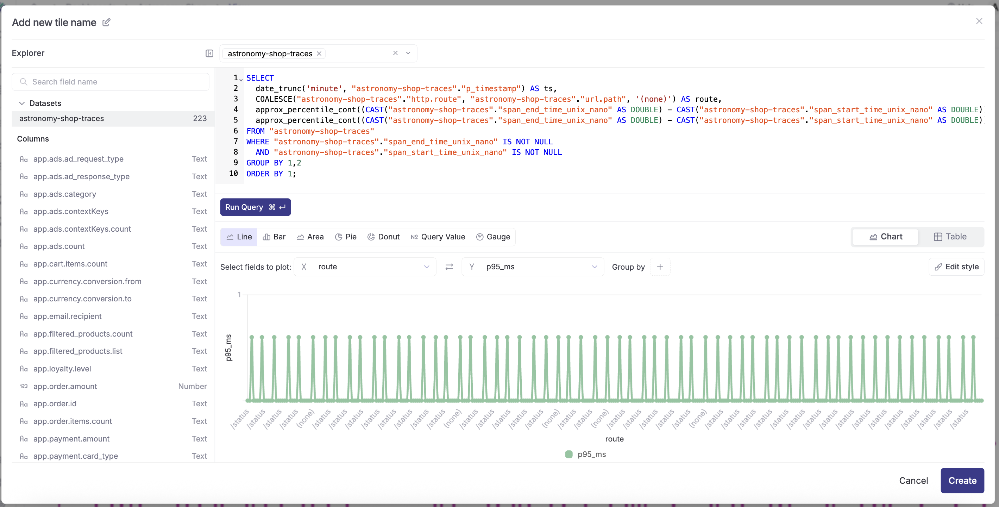
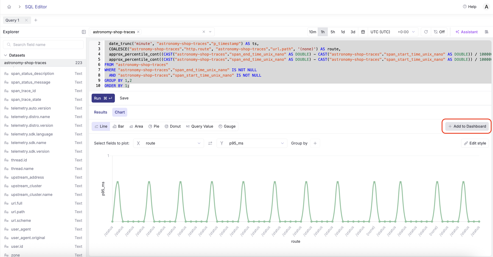
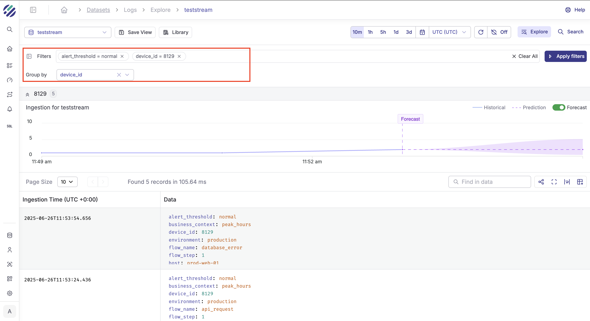
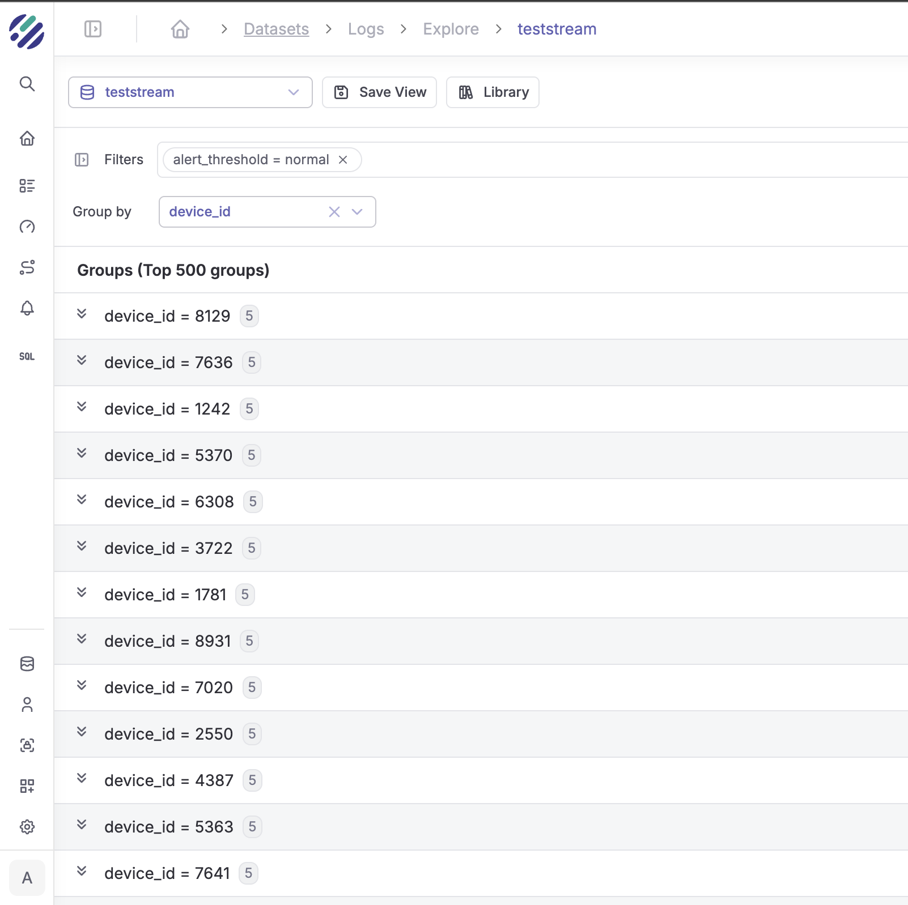
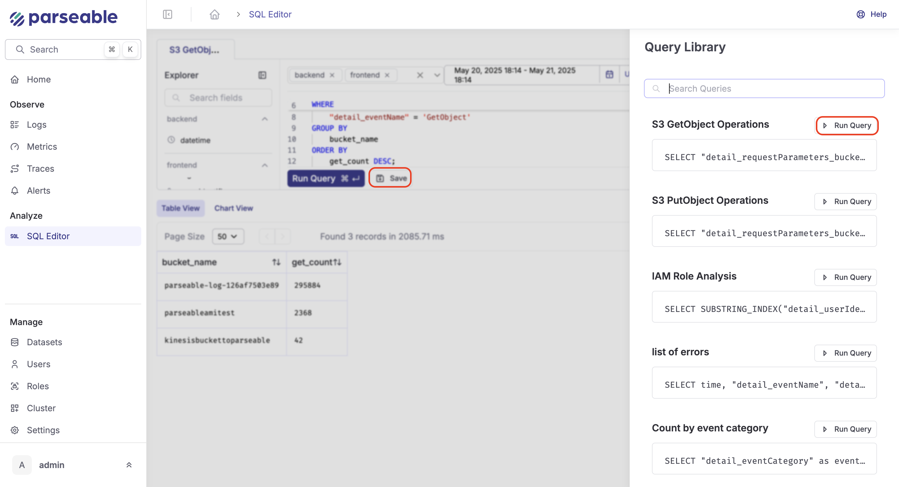

Parseable provides a powerful SQL editor that allows you to query your telemetry data (logs, metrics, and traces) using PostgreSQL compatible SQL syntax.



## Getting Started

1. Navigate to the SQL Editor in the Parseable UI
2. Browse datasets and their schemas in the sidebar
3. Write your SQL query. Autocomplete suggests available datasets and fields from loaded schemas
4. Click "Run" to execute

You can also start with one of six templates: `Recent events`, `Total count`, `Events over time`, `Latest 10 rows`, `Daily trend`, or `Unique values`. Selecting a template fills the editor and runs the query against the first available dataset.

## Features

- **Full SQL Support** - Use standard SQL queries to analyze your data
- **Auto-completion** - Get suggestions for available datasets and loaded schema fields
- **Query History** - Access your previous queries
- **Export Results** - Download query results in various formats
- **Multiple tabs** - Open up to 12 SQL editor tabs. At the limit, the New tab button is disabled and shows `Maximum of 12 tabs reached`

## Example Queries

```sql
-- Get recent data
SELECT * FROM mystream LIMIT 100

-- Count by level
SELECT level, COUNT(*) as count 
FROM mystream 
GROUP BY level

-- Filter by time range
SELECT * FROM mystream 
WHERE p_timestamp > NOW() - INTERVAL '1 hour'
```

## Query with Regular Expressions

Examples of how to use regular expressions in Parseable queries:

### Match regular expression (Case Sensitive)

```sql
SELECT * FROM frontend where message ~ 'failing' LIMIT 9000;
```

### Match regular expression (Case Insensitive)

```sql
SELECT * FROM frontend where message ~* 'application' LIMIT 9000;
```

### Does not match regular expression

```sql
SELECT * FROM frontend where message !~ 'started' LIMIT 9000;
```

### Matches the beginning/end of the string

```sql
SELECT * FROM frontend where message ~* '^a' LIMIT 9000;
SELECT * FROM frontend where message ~ 'failing$' LIMIT 9000;
```

### Replace with REGEXP_REPLACE

```sql
SELECT REGEXP_REPLACE(uuid,'[0-9]','*','g') FROM frontend LIMIT 9000;
```

### Split a string with SPLIT_PART

```sql
SELECT SPLIT_PART(email,'@',1) FROM frontend where email is not null LIMIT 10;
```

### Pattern matching with LIKE

```sql
SELECT * FROM frontend where email LIKE '%test%' LIMIT 10;
```

## Case Sensitivity

Dataset column names are case sensitive. To query column names with uppercase letters, use double quotes:

```sql
SELECT * FROM dataset WHERE "Foo" = 'bar'
```

## Query Analysis

To view the detailed query execution plan, use the `EXPLAIN ANALYZE` keyword:

```sql
EXPLAIN ANALYZE SELECT * FROM frontend LIMIT 100
```

## Response Fields Information

To get the query result fields as a part of query API response, add the query parameter `fields=true`:

```
http://localhost:8000/api/v1/query?fields=true
```

## Visualize Query Results

SQL results support Line, Bar, Stacked bar, Area, Pie, Donut, Query value, Gauge, Table, Bubble, Scatter, Sankey, and Heatmap views.

A heatmap requires an X-axis field, a numeric value field, and at least one group-by field to use as the Y-axis category. Use the `X`, `Y`, and `Value` controls to configure the heatmap. Heatmaps do not display the standard legend or crosshair.

## Add Charts to Dashboard

After running a query, you can visualize the results and add them directly to a dashboard.



## Filters and Group By

Use the filter panel to slice and dice your data, and group results by any field.





## Query Library

Saved SQL queries are available in a searchable query-library sheet. Use the Save and Update controls to create and update saved queries.



## Tips

- Use `p_timestamp` for time-based filtering
- Use `LIMIT` to prevent large result sets
- Use `GROUP BY` for aggregations
- For AI-powered query generation, see [Text to SQL](/user-guide/ai-native/text-to-sql)
